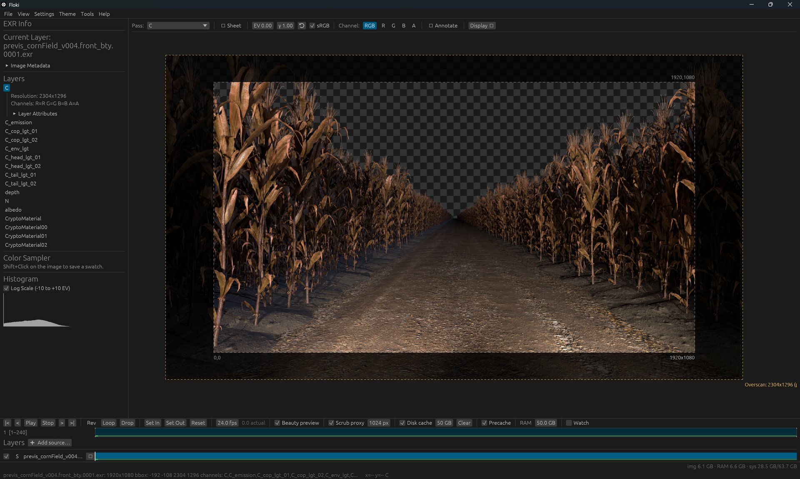
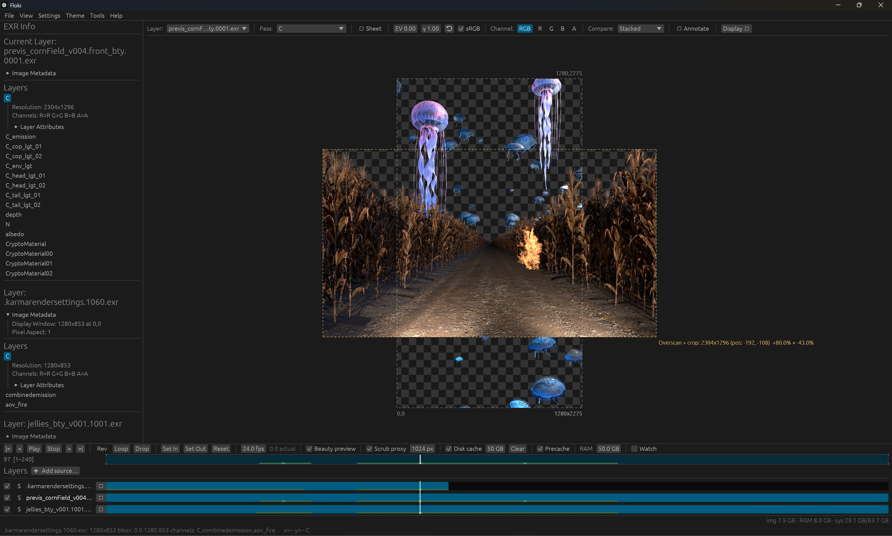
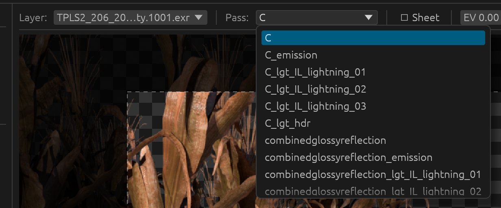
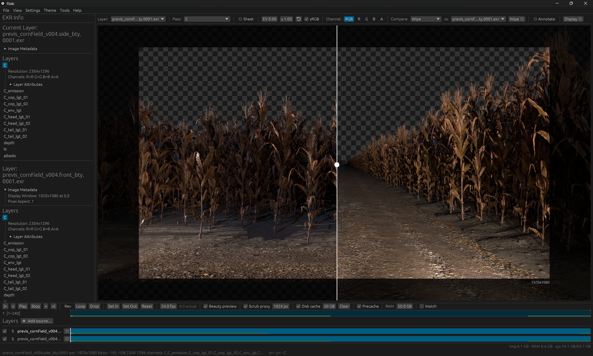
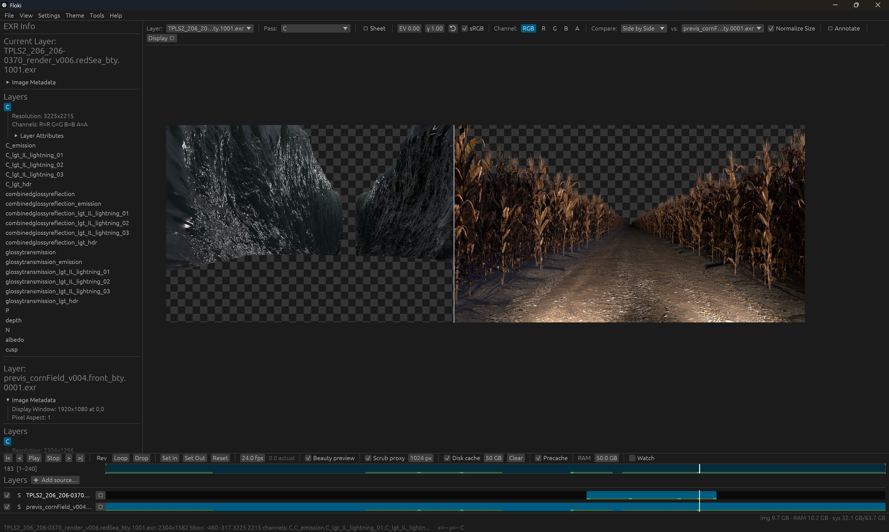
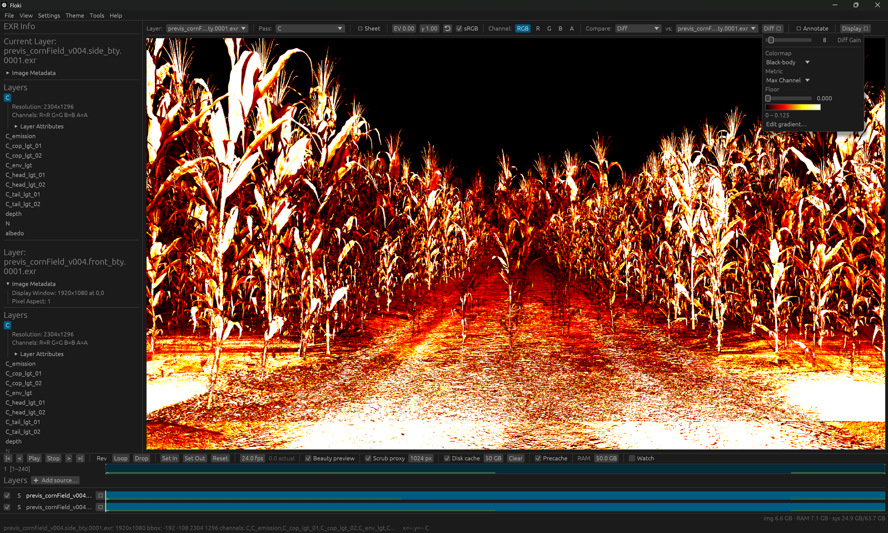
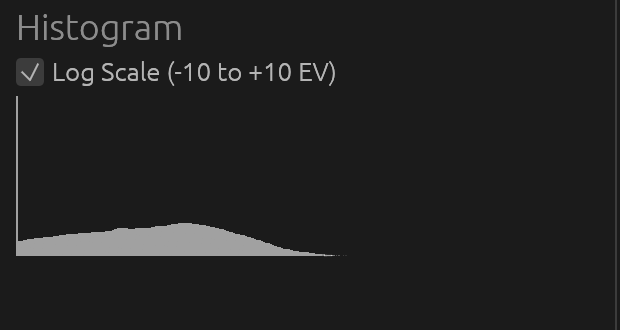
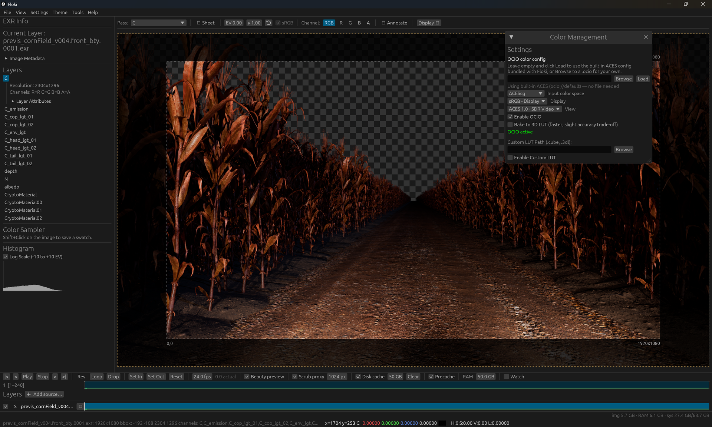

# Floki

[](https://www.rust-lang.org)
[](https://github.com/emilk/egui)
[](https://wgpu.rs)
[](https://opensource.org/licenses/MIT)
[](https://ko-fi.com/byvfx)

**Floki** is a fast, hardware-accelerated Rust GUI application tailored for Technical Directors, Compositors, and LookDev Artists who need to deeply inspect and compare multi-layered OpenEXR files. 

Powered by `egui`, `wgpu`, and the pure-Rust `exr` crate, it allows you to instantly view dense pixel data, isolate color channels, explore unbounded floating-point histograms, and stack renders as layers to composite and pixel-perfect diff them against each other — all rendered natively on your GPU — as well as **play image sequences in real time**.



---

## Key Features

### Hardware-Accelerated Rendering
* **Vulkan/Metal/DX12 Backend:** All image exposure scaling, gamma correction, sRGB mapping, and difference-matte compositing are executed via custom WGSL shaders on the GPU.
* **GPU-Required Pipeline:** All rendering runs on the GPU via `wgpu` (Vulkan/Metal/DX12); a working GPU and driver are required to launch. *(An internal CPU render path exists for contact-sheet thumbnails and headless tests — it is not a runtime fallback for a missing GPU.)*

### Layers & Compositing
Every EXR you open becomes a **layer** in an ordered stack — there is no special "first" image and no separate reference slot. Drop files onto the window, use `File ▸ Open EXR...`, or hit **➕ Add source…** in the panel; stack as many as the shot needs.
* **Per-layer controls:** visibility and **solo** sit in the row gutter; the row's `⋮` menu holds blend mode (Over, Under, Add, Multiply, Screen), opacity, the **pass/AOV picker** for that layer's source, a pixel-aspect override, reorder, and remove. **Duplicate layer** gives you a second view of the same source with no extra decode — useful for comparing two AOVs of one render against each other.
* **Timeline tracks:** each layer is a clip on a shared frame axis. Drag a clip to slide that layer against the global playhead (or type an exact offset) to line up takes that start on different frames; a fill strip under each track shows what is resident in the cache.
* **The current layer** — click a row's name — is what the toolbar's channel and tone controls, the pixel readout, the histogram, and the contact sheet all act on. The composite keeps rendering underneath.
* Toggle the panel from **View ▸ Layer tracks**.


*The Layers panel — an ordered stack of sources with per-layer blend, opacity, solo and trim, laid out as timeline tracks over a shared frame axis.*


*Each layer picks its own pass, so one render's AOVs can be stacked, blended, and compared against each other.*

### Image-Sequence Playback
Open one frame of a numbered sequence (e.g. `render.0101.exr`) and play the whole shot — Floki is a review player, not just a still viewer.
* **Transport & timeline:** Play/pause, step, reverse, and stop-in-place, with a scrubber/timeline that highlights the trimmed region and marks any missing frames (holes). Editable target fps with a live measured-fps readout.
* **Loop & pacing:** Loop, Once, or Ping-Pong; choose **Stutter** (play every frame; fps drops under load) or **Drop-frames** (hold the wall-clock rate; skip frames) pacing.
* **In/out trim:** Set in/out points to review just a section — the cache and playback respect the trim.
* **Smart cache:** A byte-budgeted ring keeps decoded frames resident in RAM within a *live* memory budget, so scrub-backs and loops are instant and playback degrades gracefully instead of crashing under memory pressure.
* **Beauty-only fast decode:** While playing, only the beauty/first layer is decoded for a much faster, lighter cache on heavy multi-part AOV EXRs; the paused frame re-decodes in full so the pixel readout and AOV switch stay accurate.
* **Eager precache:** Optionally cache the whole in/out range up front — a green fill bar under the scrubber shows what's resident — so the span plays and loops with the decoder idle.
* **Live render-watch:** Watch the sequence folder and pick up frames as a render writes them (new frames extend the range; re-rendered frames refresh), optionally parking the playhead on the newest frame.


*Real-time sequence playback — the scrubber highlights the trimmed in/out region, the green bar shows the cached range, and target/measured fps read out live.*

### Deep Inspection
* **Precision Pixel Sampling:** Hover over any pixel to reveal exact floating-point values (R, G, B, A) regardless of bit-depth (F16, F32, U32).
* **Persistent Swatches:** `Shift + Click` on the image to drop a permanent color swatch into your toolbelt for cross-referencing.
* **Metadata Explorer:** Cleanly displays embedded EXR attributes (like V-Ray/Arnold custom tags), passes, and bounding box data in collapsible panels — the current layer's source first, then the rest of the stack, so a mixed-format comp can be read top to bottom in one place.
* **Contact Sheet:** Press `T` (or **View ▸ Contact Sheet**) to see every AOV and pass of the current layer's source as a scrollable grid of thumbnails. Click a cell to point that layer at the pass — the fastest way to go from "what is in this render" to looking at it.


*Contact sheet — every AOV and pass of the current layer as a thumbnail grid; click one to switch the layer to it.*

### Comparison
With more than one layer in the stack, a **Compare** picker appears in the toolbar. Side A is always the live composite; the **vs:** picker chooses which layer it is shown against, independently of which layer is current.
* **Stacked:** the ordinary composite — layers blended in stack order by their own blend modes and opacities.
* **Wipe:** split-screen slider for boundary checks, with adjustable centre, rotation angle, and divider-line opacity — drag the on-image handle, or scroll it to rotate. Wipes at any orientation.
* **Side-by-Side:** the two panes glued into a continuous panorama sharing one camera, so panning and zooming stay synchronized. **Normalize Size** matches the compare layer's height to pane A's when the two are different formats.
* **Diff:** renders the magnitude of the difference as a false-colour heat map to spot fractional floating-point discrepancies. Choose the colormap (black-body, grayscale, turbo, viridis, magma, inferno) or build a custom multi-stop gradient in the editor; select the magnitude metric (max channel, Rec.709 luminance, or per-channel RGB); set a noise-floor threshold to ignore sub-threshold noise; and read values off the on-screen legend.
* **Blink:** alternates the two panes on a timer, with an adjustable interval from 0.05 s to 5 s. It runs on its own clock, so it keeps flipping while you pan, zoom, and sample.

The comp toolbar stays a single row: each arrangement's parameters live behind its own `Wipe ▾` / `Diff ▾` menu, next to the picker that selected it.


*Wipe — drag the divider at any angle to check the composite against any layer in the stack.*


*Side-by-side — both panes share one camera for synchronized panning and zooming.*


*Diff — the magnitude of the difference as a false-colour heat map, with the value legend on-screen.*

### Image Analysis
* **Dynamic Luminance Histogram:** Real-time histogram mapped to Exposure Values (EV stops). Effortlessly spot floating-point highlights over `1.0` using the Logarithmic view.
* **Log view:** switch the histogram to a logarithmic scale to pull detail out of the shadows without losing the highlights above `1.0`.
* **Channel Isolation:** Quickly isolate `R`, `G`, `B`, `A`, or view `RGB` composite with single-key shortcuts.


*EV histogram — the current layer's luminance mapped to exposure stops, so highlights over 1.0 stay visible instead of clipping off the end.*

### Color Management
* **OpenColorIO (built in):** OCIO is compiled into every build — there is no non-OCIO build. Point Floki at a config and pick the display/view transform to see your footage in the right space; it auto-enables when a config loads and can be toggled on/off from **Color Management**. The transform runs on the GPU and can optionally be baked to a 3D LUT for smoother pan/zoom on weaker GPUs.
* **3D LUT Support:** Load Adobe `.cube` 3D LUTs and apply them in real time on the GPU as a display transform, alongside the built-in Exposure/Gamma/sRGB controls.


*Color Management — point Floki at an OCIO config and pick the display/view transform; the transform runs on the GPU.*

### Customizable Viewport Background
* **Background Modes:** Replace the default transparency checkerboard with a checkerboard (custom cell colours and size), a solid colour, or a multi-stop gradient at any angle — set from **View ▸ Viewport Background**. Save named presets that persist across sessions. The background composites consistently across the GPU and OCIO display paths.

| Checkerboard | Solid | Gradient |
|:---:|:---:|:---:|
|  |  |  |

### Snapshot & Review
* **Snapshot to Clipboard:** Copy exactly what's on screen to the system clipboard with `Cmd/Ctrl + Shift + S` (or **View ▸ Snapshot to Clipboard**) — background, compare mode, OCIO, and annotations all included. Optionally also save a timestamped PNG to `~/.floki/snapshots/`.
* **Annotation Overlay:** Mark up the view with arrows, boxes, a freehand pen, and text labels (adjustable colour and stroke width) before snapshotting. Annotations anchor to image pixels so they track pan/zoom, support undo/redo and clear-all, and are flattened into the snapshot automatically.


*Annotation overlay — arrows, boxes, freehand pen, and text labels anchor to image pixels and flatten into the snapshot.*

### Batch Tooling
* **EXR Header Converter:** Bulk-rename channels across an entire directory to standard RGBA — available both as an in-app Tools window and a headless `convert_dir` CLI, parallelized across CPU cores via `rayon` with live progress and cancellation.

### High-Performance UI
* **Immediate-Mode UI:** Built on `egui` for a responsive, minimal-overhead interface.
* **Light / Dark / System Themes:** Switch the interface theme from the **Theme** menu; the `System` option tracks your OS light/dark setting live. Your choice persists across sessions.
* **Recent Files:** `File ▸ Open Recent` reloads a recent EXR as a new layer.
* **Drag & Drop Loading:** Drop EXRs anywhere on the window to add them to the stack — a single overlay confirms the drop, and dropping several at once adds them all, in drop order.
* **Persistent State:** Remembers your UI layout, recent files list, theme, and preferences across sessions.
* **Software Tone Mapping:** Apply Exposure, Gamma, and sRGB transforms instantly without altering the underlying raw data.
* **Resource Monitor:** A discrete status-bar readout tracks floki's own memory footprint and system RAM, plus live GPU **VRAM** usage on macOS — handy when loading heavy EXRs or sequences. It samples about once a second and tucks into the bottom-right. (The VRAM figure is macOS/Metal only for now; Windows and Linux show RAM.)

---

## Keyboard Shortcuts

| Shortcut | Action |
|----------|--------|
| `F` | Frame Image (Reset Zoom & Pan to fit screen) |
| `R` | Isolate Red Channel |
| `G` | Isolate Green Channel |
| `B` | Isolate Blue Channel |
| `A` | Isolate Alpha Channel |
| `C` | View Full RGB (Color) |
| `T` | Show / hide the Contact Sheet |
| `E` | Reset exposure to 0 EV |
| `Shift + G` | Reset gamma to 1.0 |
| `F11` | Toggle fullscreen (hides the menu bar and panels) |
| `Cmd/Ctrl + Shift + S` | Snapshot the current view to the clipboard |
| `Esc` | Cancel the active annotation tool (or exit fullscreen) |
| `Shift + Click` | Sample pixel and save to swatch palette |
| `Scroll Wheel` | Zoom in/out at cursor |
| `Click + Drag` | Pan Image |
| `Drag & Drop` | Drop EXRs anywhere on the window to add them as layers |

With a sequence loaded, the transport keys are live:

| Shortcut | Action |
|----------|--------|
| `Space` | Play / pause |
| `←` / `→` | Step one frame back / forward |
| `I` / `O` | Set the in / out points of the play range |

---

## Installation & Building

Make sure you have [Rust and Cargo](https://rustup.rs/) installed on your system.

```bash
# Clone the repository
git clone https://github.com/byvfx/floki.git
cd floki

# Build and run — needs no OpenColorIO installed (see the tiers below)
cargo run --release --no-default-features
```

> **On a clean machine, use `--no-default-features`.** The default build links an
> *installed* OpenColorIO and fails at build time if it can't find one. The flag
> selects the pure-Rust stub backend — no native dependencies, no C++ toolchain —
> which is also what CI builds and lints. Colour management is then limited to the
> built-in transforms; see the three tiers below to get full OCIO.

### Color management (OpenColorIO)

OCIO support is **always compiled** — it is mandatory, not an opt-in feature. What you choose
is the *backend*, and there are three tiers. A bare `cargo run` uses the system backend, which
is why it fails on a machine with no OCIO installed.

| Tier | Command | Needs | Gets you |
|---|---|---|---|
| **Stub** | `cargo run --release --no-default-features` | nothing beyond Rust | Builds and runs anywhere. Built-in transforms only — no `.ocio` config support. **This is what CI builds, lints and tests.** |
| **System** (default) | `cargo run --release` | an installed OCIO | Full OCIO, fast builds, no cmake |
| **Vendored** | `cargo ocio-run` | C++ toolchain, cmake, ninja, python3 | Full OCIO, self-contained — what the release binaries ship |

**Fast dev — link an installed OCIO (system, the default):** a plain `cargo run --release`
links an OCIO found via `OPENCOLORIO_ROOT` (any OS) or Homebrew (macOS). Fast, no cmake.

```bash
cargo run --release
```

**Recommended for distribution — self-contained (vendored):** statically builds OCIO 2.4.2
from the vendored submodule, so nothing needs to be installed system-wide. Works the same on
Windows, Linux, and macOS. The first build is slow (minutes); then it's cached.

```bash
# One short command on any OS (cargo alias from .cargo/config.toml):
cargo ocio-run

# …or, to also init the submodule in one shot (requires `just`):
just ocio
```

Prerequisites: a C++ toolchain (MSVC "Desktop development with C++" on Windows; clang/gcc
elsewhere), **cmake ≥ 3.14**, **ninja**, **python3**, and the OCIO submodule checked out
(`git submodule update --init --recursive` — done automatically by `just ocio`).

Once running, enable it in **Color Management…** (check *Enable OCIO*). With the config-path
field empty it uses the built-in ACES config, or `$OCIO` if that environment variable is set
(e.g. `OCIO=ocio://studio-config-latest`). See [`floki-ocio/README.md`](floki-ocio/README.md)
for backend/build details.

### Windows quick build (`scripts/run-windows.ps1`)

Because OCIO (and its shaderc dependency) build native code, a Windows dev box needs
`cmake` + `ninja` + `python` + the MSVC toolchain on `PATH`, plus a prebuilt OpenColorIO to
link against for the default `system-ocio` backend. Those tools usually exist but aren't on
`PATH` (cmake/ninja ship inside Visual Studio 2022; python via Anaconda). The helper script
assembles that environment (imports `vcvars64`, prepends the bundled tools, points
`system-ocio` at a vcpkg OCIO) and then runs cargo:

```powershell
scripts\run-windows.ps1 test          # fmt --check, clippy -D warnings, cargo test
scripts\run-windows.ps1               # cargo run --release  (default task)
scripts\run-windows.ps1 run -- "D:\shots\comp.exr"
```

Paths default to a common layout and are overridable via `FLOKI_VCPKG`, `FLOKI_ANACONDA`,
and `FLOKI_VSPATH`. It's a **local dev convenience only** — CI does not use it.

## Debugging & Logging

The app initializes [`env_logger`](https://docs.rs/env_logger), so runtime logging is
controlled by the `RUST_LOG` environment variable. Launch the app from a terminal so
log output (written to `stderr`) is visible.

```powershell
# PowerShell — watch the EXR Header Converter work through a batch
$env:RUST_LOG = "floki=debug"
cargo run --release
```

```bash
# bash / zsh
RUST_LOG=floki=debug cargo run --release
```

Useful levels (prefix the target with `floki=` to filter out noisy `wgpu`/`eframe` logs):

| `RUST_LOG` value | What you see |
|------------------|--------------|
| `floki=info` | Conversion start line, final summary (`N of X files converted`), and any errors |
| `floki=debug` | The above plus a line per converted file and any layer left unchanged by the rename guard |
| `info` | Everything at info level, including `wgpu`/`eframe` startup |
| `floki=info,wgpu=warn` | App info logs while silencing graphics-backend chatter |

> **Note:** During batch conversion, files are processed in parallel across CPU cores, so
> per-file log lines appear interleaved/out of order. The count in the final summary is
> authoritative.

## Architecture

A birds-eye view of the workspace. The app ships as a single binary backed by a
library crate (so benches and integration tests can reach the internals), plus a
standalone `floki-ocio` crate that wraps OpenColorIO.

**App shell**
- **`main.rs`** — entry point and `eframe` / `wgpu` initialization.
- **`app.rs`** — the top-level `eframe::App`: window and menus, async EXR + LUT loading, snapshot capture, persistence, and the panel layout that hosts the viewer.
- **`resource_monitor.rs`** — throttled RAM / GPU-VRAM sampler feeding the status-bar readout.

**Image data**
- **`exr_loader.rs`** — threaded OpenEXR decode and logical-layer grouping via the `exr` crate (the load hot path the benches exercise).

**Viewer & rendering**
- **`viewer.rs`** — the heavy lifter: canvas pan/zoom, the six compare modes, pixel sampling, histograms, contact sheets, and the GPU render path (plus a CPU path used for contact-sheet thumbnails and headless tests, not as a missing-GPU fallback).
- **`gpu/`** — the `wgpu` backend: `mod.rs` (pipelines, uniforms, bind groups), `shader.wgsl` (the display / compare / diff / background fragment shader), and `ocio_pass.rs` (the two-pass OCIO display transform and blit).
- **`render_math.rs`** — shared tone-mapping math (exposure / gamma / sRGB), unit-tested in one place.

**Visualization & overlays**
- **`gradient.rs`** — reusable multi-stop gradients and the diff colormaps (shared by the heat map and the gradient background).
- **`background.rs`** — the customizable viewport background (checker / solid / gradient), sampled identically across every render path.
- **`annotation.rs`** — the transient arrow / box / pen / text overlay model.
- **`snapshot.rs`** — framebuffer-screenshot capture plus the clipboard / PNG helpers.

**Color management**
- **`color/cube.rs`** — Adobe `.cube` 3D-LUT parsing.
- **`floki-ocio/`** — a standalone crate wrapping OpenColorIO over FFI, with a GLSL→WGSL shader transpiler; always linked (the `system-ocio` / `vendored` features select the native backend).

**Sequence playback**
- **`sequence.rs`** — numbered-sequence detection: parsing, numeric sort, and hole detection.
- **`playback.rs`** — the transport state machine (playhead, loop modes, in/out trim, pacing) and the pure frame-advance logic.
- **`scheduler.rs`** — the pure decode want-list / next-frame scheduler (priority order, prefetch window).
- **`cache.rs`** — the byte-budgeted T1 ring of decoded frames with directional-ring + LRU eviction.
- **`budget.rs`** — the RAM budget math sizing the T1 ring from a live memory sample.
- **`pixels.rs`** — pure pixel access over decoded EXR channels + thumbnail decimation.
- **`prefetch.rs`** — read-ahead file warmer; overlaps the next frame's file read with the current decode via the OS page cache.
- **`proxy_cache.rs`** — persistent on-disk proxy cache (`~/.floki/proxy-cache`), so a scrub proxy's first-touch decode is paid once ever.
- **`tex_upload.rs`** — off-thread comp-texture upload; the paint thread submits a frame and collects a finished GPU texture instead of interleaving and uploading inline.
- **`layer.rs`** — the pure comp layer-stack model backing A/B compare (the spine for N-way / locked-step).

**Tooling & CLI**
- **`tools.rs`** — the multi-threaded EXR Header Converter (batch channel renaming via `rayon`) with progress reporting and `RUST_LOG` logging.
- **`bin/`** — headless helpers: `convert_dir` (batch rename), `inspect_exr`, and `check_types`.

## License

This project is licensed under the MIT License - see the [LICENSE](LICENSE) file for details.
