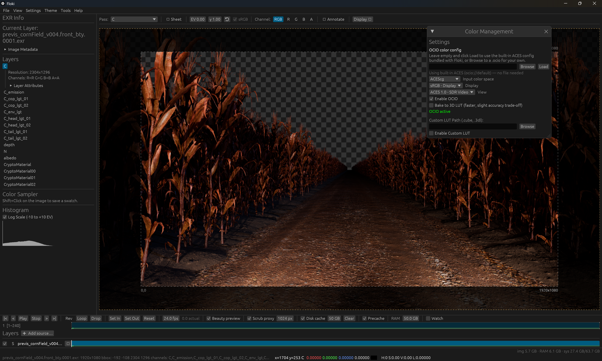

Floki's display transform is OpenColorIO when a native backend is linked, plus Adobe `.cube` 3D LUTs and the built-in exposure, gamma, and sRGB controls. The OCIO transform runs on the GPU. It can optionally be baked to a 3D LUT for smoother pan and zoom on weaker GPUs.

Point Floki at a config and pick the display/view transform in **Color Management**. OCIO auto-enables when a config loads and can be toggled off from that panel. With the config-path field empty, Floki uses the built-in ACES config, or `$OCIO` if that variable is set (for example `OCIO=ocio://studio-config-latest`).



`.cube` files are parsed by [`src/color/cube.rs`](https://github.com/byvfx/floki/blob/main/src/color/cube.rs) into an RGBA `Vec<[f32; 4]>` and uploaded as an `Rgba32Float` 3D texture. Sampling that texture is why the wgpu device requests `FLOAT32_FILTERABLE`. See [Troubleshooting](Troubleshooting).

## Build tiers

`floki-ocio` is always compiled. Features only select the native backend. With neither native feature, the crate is pure-Rust stubs and every OCIO call returns `OcioError::NotCompiled`, so unrelated builds never need a C++ toolchain. Colour management is then the built-in transforms and `.cube` LUTs.

| Feature | What it does |
|---|---|
| `system-ocio` | Links an externally provided OCIO (Homebrew / `OPENCOLORIO_ROOT`) and Imath headers (Homebrew / `IMATH_ROOT`). **Dev default** — OCIO is linked, not cmake-built. |
| `vendored-ocio` | Statically builds OCIO 2.4.2 from the vendored submodule via cmake. **Distributable** — the binary needs no installed OCIO. The app feature is named `vendored`. |

If both are enabled, `vendored-ocio` wins. A self-contained build never falls back to a system OCIO.

| Tier | Command |
|---|---|
| Stub | `cargo run --release --no-default-features` |
| System (default) | `cargo run --release` |
| Vendored | `cargo ocio-run` |

`OPENCOLORIO_ROOT` is an install prefix containing `include/` and `lib/`. On macOS, `brew --prefix opencolorio` is the fallback when that variable is unset. Imath headers are separate: `IMATH_ROOT` (the build adds `$IMATH_ROOT/include`) or `brew --prefix imath`. If neither is set, the extra include is omitted. `build.rs` reruns when either variable changes. Platform setup is on [Windows](Install-Windows), [macOS](Install-macOS), and [Linux](Install-Linux). The full table of toolchains is on [Install](Install#the-three-build-tiers).

## What the crate exposes

[`floki-ocio`](https://github.com/byvfx/floki/blob/main/floki-ocio/README.md) is UI- and graphics-API-agnostic. It exposes three things, none of which depend on egui or wgpu:

- **Config + enumeration** (`OcioConfig`) — load from a file, a built-in (`ocio://default`), or `$OCIO`; list color spaces, displays, and views.
- **CPU processing** (`CpuProcessor`) — apply a display transform to RGBA f32 in place (thumbnails, batch baking).
- **GPU shader bundle** (`GpuShaderBundle`) — an OCIO-generated fragment shader as SPIR-V (and optional WGSL) with LUT textures and binding reflection.

The vendored OCIO source is a git submodule pinned to **v2.4.2**. After cloning:

```sh
git submodule update --init --recursive
cargo build --release --no-default-features --features vendored
```

`build.rs` cmake-builds it static (`BUILD_SHARED_LIBS=OFF`) with apps, tests, python, and docs off, and `OCIO_INSTALL_EXT_PACKAGES=ALL` (OCIO builds its own Imath, yaml-cpp, expat, pystring, and minizip-ng). The first build compiles OCIO and those dependencies; later builds are incremental.

Convenience wrappers, from [`.cargo/config.toml`](https://github.com/byvfx/floki/blob/main/.cargo/config.toml) and the [`justfile`](https://github.com/byvfx/floki/blob/main/justfile):

```sh
cargo ocio-run     # run with vendored OCIO (submodule must be checked out)
cargo ocio-build   # build only
cargo ocio-test    # static-link smoke test
just ocio          # inits the submodule first, then runs
```

Native backends need a C++ toolchain, `python3`, and `make` or `ninja` (the GLSL→SPIR-V shaderc step). **`vendored-ocio` additionally needs `cmake` ≥ 3.14** to build OCIO. CMake 4 works.

Exposure and gamma still apply in the OCIO view (gamma-in-OCIO is the #93 / #95 fix). Contrast, hue, saturation, white balance, and soft-clip are not in the app yet — they are [#102](https://github.com/byvfx/floki/issues/102) on the [review player roadmap](Review-player-roadmap).
