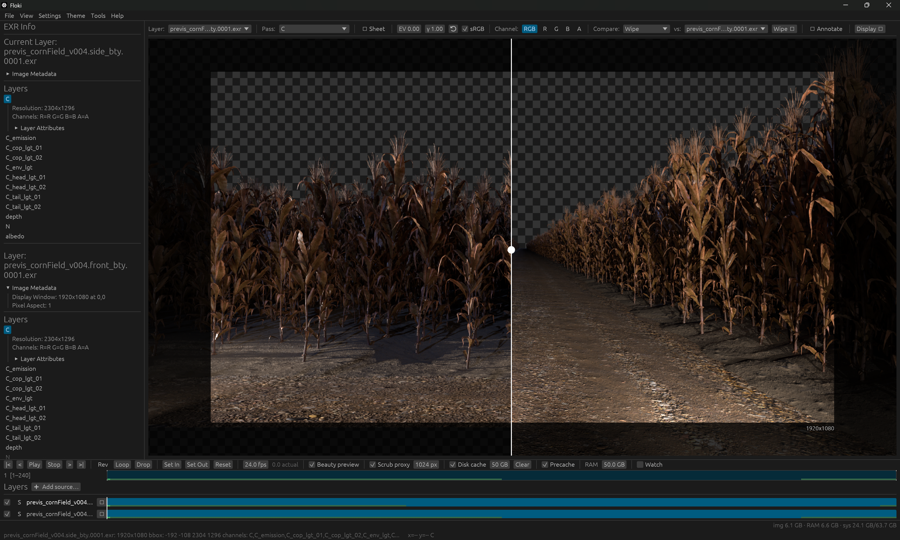
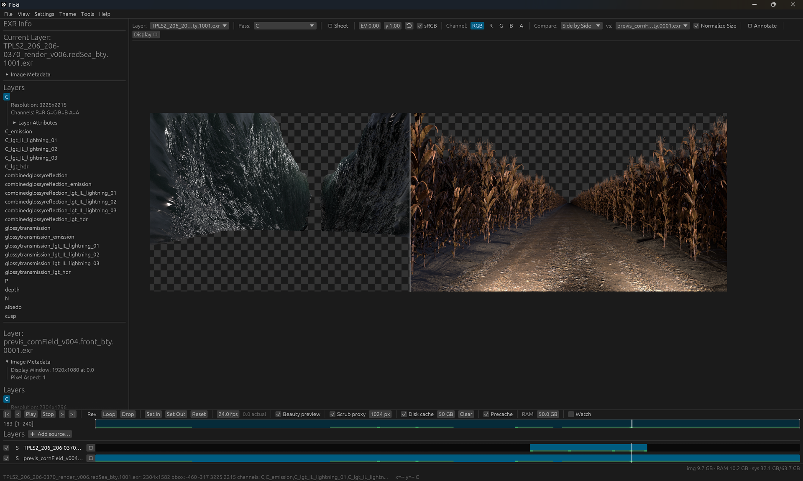
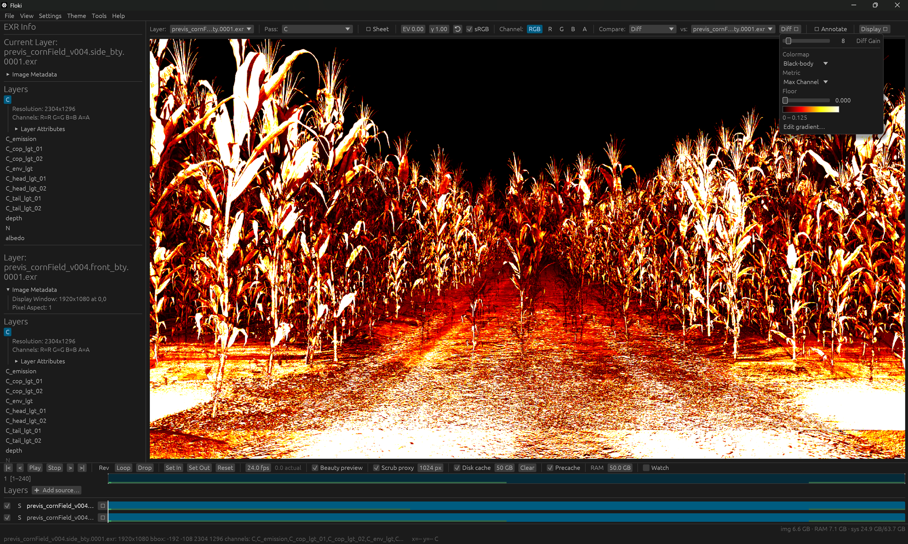

With more than one layer in the stack, a **Compare** picker appears in the toolbar. Outside **Stacked**, side A is the **current layer alone** — not the composite — and the **vs:** picker chooses which layer it is shown against. Changing the current layer changes what you are comparing.

The comp toolbar stays a single row. Each arrangement's parameters live behind its own `Wipe ▾` / `Diff ▾` menu, next to the picker that selected it.

| Arrangement | What you see |
|---|---|
| **Stacked** | The ordinary composite. Layers blend in stack order by their own blend modes and opacities. |
| **Wipe** | A split-screen slider for boundary checks. Centre, rotation, and divider-line opacity are adjustable. Drag the on-image handle, or scroll it to rotate. |
| **Side-by-Side** | The two panes glued into a continuous panorama sharing one camera, so pan and zoom stay synchronized. **Normalize Size** matches the compare layer's height to pane A's when the two are different formats. |
| **Diff** | The magnitude of the difference as a false-colour heat map. |
| **Blink** | The two panes alternate on a timer, from 0.05 s to 5 s. Blink runs on its own clock, so it keeps flipping while you pan, zoom, and sample. |

## Diff options

- Colormap: black-body, grayscale, turbo, viridis, magma, inferno, or a custom multi-stop gradient.
- Magnitude: max channel, Rec.709 luminance, or per-channel RGB.
- A noise-floor threshold ignores sub-threshold differences.
- Values read off the on-screen legend.

Diff is an operator over the two visible layers. It is not a blend mode. The blend modes on a layer (Over, Under, Add, Multiply, Screen) are what **Stacked** uses.

A compare is still two panes (current vs `vs:`). Comparing up to four inputs at once is [#104](https://github.com/byvfx/floki/issues/104), tracked on the [review player roadmap](Review-player-roadmap).

Without a sequence loaded, `Space` toggles blink. With a sequence loaded, `Space` is play/pause and is consumed so blink does not also fire. See [Keyboard shortcuts](Keyboard-shortcuts).
