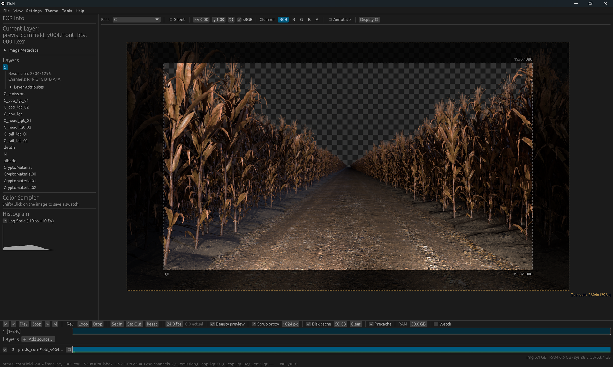

<!-- wiki-only -->

> [!NOTE]
> The full docs, with search, are at
> [byvfx.github.io/floki](https://byvfx.github.io/floki/). This wiki mirrors the
> same pages.

<!-- /wiki-only -->

**Floki** inspects, compares, and plays multi-layer image sequences with color-accurate OCIO viewing. It is a GPU-accelerated viewer for technical directors, compositors, and look-dev artists: exposure, gamma, sRGB, channel isolation, and difference mattes run in a WGSL shader, and a numbered EXR sequence plays back in real time.

> [!TIP]
> New here? [Install](Install) covers the prebuilt binaries and the three OpenColorIO build tiers. The viewer tour starts at [Layers and compositing](Layers-and-compositing).

<table>
<tr>
<td width="33%" valign="top">

### Start here
[Install](Install) 
[Windows](Install-Windows) · [macOS](Install-macOS) · [Linux](Install-Linux) 
[Color management](Color-management) 
[Troubleshooting](Troubleshooting)

</td>
<td width="33%" valign="top">

### Using Floki
[Layers and compositing](Layers-and-compositing) 
[Playback](Playback) 
[Comparison](Comparison) 
[Inspection](Inspection) 
[Batch tools](Batch-tools) 
[Keyboard shortcuts](Keyboard-shortcuts)

</td>
<td width="33%" valign="top">

### Working on Floki
[Developing](Developing) 
[Testing](Testing) 
[Architecture](Architecture) 
[Releasing](Releasing) 
[Patched exr fork](Patched-exr-fork)

</td>
</tr>
<tr>
<td valign="top">

### Design notes
[Memory contract](Memory-contract) 
[Concurrency contract](Concurrency-contract) 
[Sequence playback](Sequence-playback) 
[Layer model](Layer-model)

</td>
<td valign="top">

### Roadmaps
[Review player roadmap](Review-player-roadmap) 
[Perf roadmap](Perf-roadmap) 
[Cross-player benchmark](Cross-player-benchmark)

</td>
<td valign="top">

### Something broke?
Launch needs a GPU with `FLOAT32_FILTERABLE`. Logging is `RUST_LOG`. See [Troubleshooting](Troubleshooting).

</td>
</tr>
</table>
