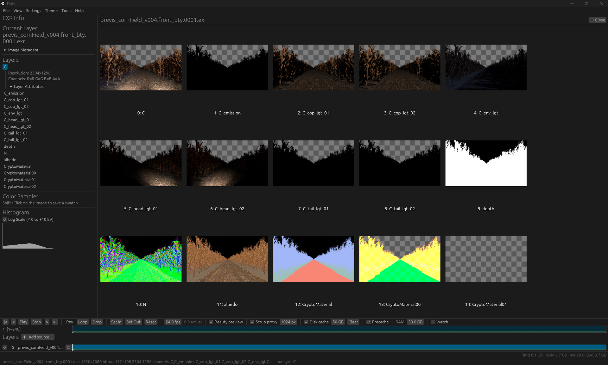
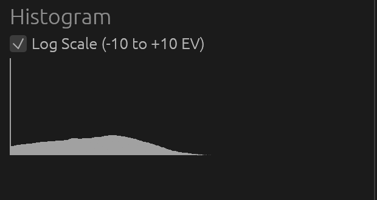
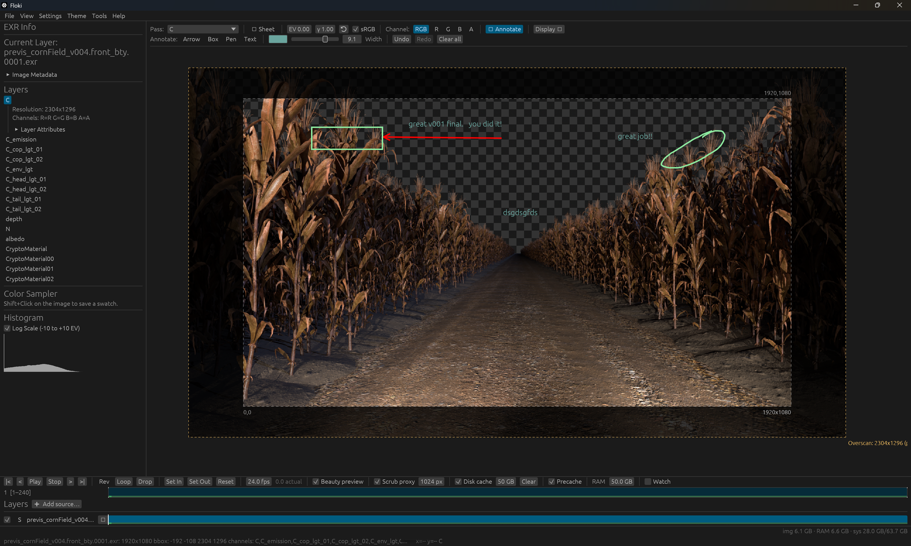

## Pixel readout

Hover any pixel for the exact floating-point R, G, B, and A, regardless of bit depth (F16, F32, U32). The readout follows whatever is actually on top: the composite's topmost drawable layer in Stacked mode, or pane A's layer in a compare.

`Shift + Click` drops a permanent color swatch into the toolbelt.

While a sequence is playing, the readout is served from the proxy or suppressed. Pause to re-decode the playhead in full before trusting a sample. That rule is INV-SAMPLE in the [memory contract](Memory-contract).

## Metadata

Embedded EXR attributes (including renderer tags such as V-Ray and Arnold), passes, and bounding-box data sit in collapsible panels. The current layer's source is first, then the rest of the stack, so a mixed-format comp reads top to bottom in one place.

## Contact sheet

Press `T`, or **View ▸ Contact Sheet**, to see every AOV and pass of the current layer's source as a scrollable grid of thumbnails. Click a cell to point that layer at the pass.

Single-key channel shortcuts are quiet while the sheet is open. `T` still closes it. See [Keyboard shortcuts](Keyboard-shortcuts).

## Histogram and channels

The luminance histogram is mapped to exposure values, so highlights over `1.0` stay on the chart. Logarithmic view pulls shadow detail out without clipping those highlights. The histogram follows the current layer.

`R`, `G`, `B`, and `A` isolate a channel. `C` returns to RGB. `E` resets exposure to 0 EV. `Shift + G` resets gamma to 1.0. These are global view settings, not per-layer.

## Viewport background

**View ▸ Viewport Background** replaces the default transparency checkerboard with a checkerboard (custom cell colours and size), a solid colour, or a multi-stop gradient at any angle. Named presets persist across sessions. The background composites the same way on the GPU path and the OCIO display path.

## Snapshots and annotations

`Cmd/Ctrl + Shift + S`, or **View ▸ Snapshot to Clipboard**, copies exactly what is on screen: background, compare mode, OCIO, and annotations. Floki can also save a timestamped PNG to `~/.floki/snapshots/`.

The annotation overlay is arrows, boxes, a freehand pen, and text labels, with adjustable colour and stroke width. Annotations anchor to image pixels, so they track pan and zoom. Undo, redo, and clear-all are supported, and the marks are flattened into the snapshot. `Esc` cancels the active tool (or leaves fullscreen when nothing is in progress).

Animated brush-sequence notes and text as real comp layers are not this overlay. They are still ahead of the [layer model](Layer-model).
