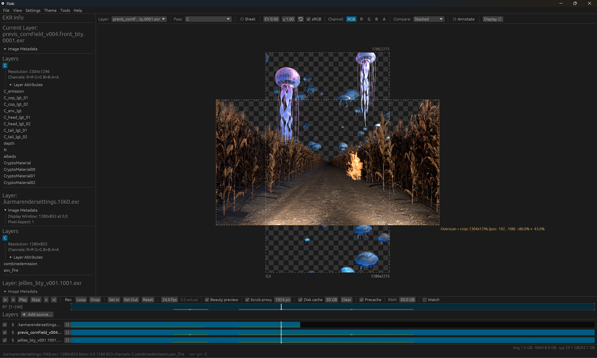
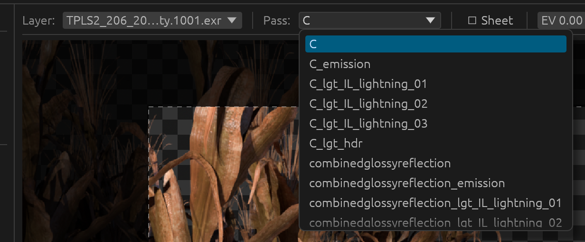

Every EXR you open becomes a **comp layer** in an ordered stack. There is no special first image and no separate reference slot. Drop files onto the window, use **File ▸ Open EXR…**, or hit **➕ Add source…** in the panel. Stack as many as the shot needs.

A comp layer is a placed source (the review-player meaning, closer to Chaos Player or Nuke). A **logical layer** is an AOV inside one EXR (`diffuse.R` / `diffuse.G` grouped by dotted-name prefix). Each comp layer picks one logical layer of its source. The split is the [layer model](Layer-model).

## Per-layer controls

Visibility and **solo** sit in the row gutter. The row's `⋮` menu holds:

- blend mode (Over, Under, Add, Multiply, Screen)
- opacity
- the pass / AOV picker for that layer's source
- a pixel-aspect override (it affects that layer only; siblings keep their own)
- reorder and remove

**Duplicate layer** is a second view of the same source with no extra decode — useful for comparing two AOVs of one render. A file that is already in the stack is focused instead of loaded again. Use **Duplicate layer** when you want a second view of the same source.

## The current layer

Click a row's name to make it current. The histogram and the contact sheet act on that layer, and it is what pane A shows in a compare. Channel isolation and the tone controls are *global* view settings: they apply to the whole view, not to the selected row.

The pixel readout follows whatever is actually on top — the composite's topmost drawable layer in Stacked mode, pane A's layer in a compare. The composite keeps rendering underneath.

Solo overrides visibility: if any layer is soloed, only the soloed layers render; otherwise every enabled layer renders.

## Timeline tracks

Each layer is a clip on a shared frame axis. Drag a clip to slide that layer against the global playhead (or type an exact offset) to line up takes that start on different frames. A fill strip under each track shows what is resident in the cache. Trim in/out points are per layer. Toggle the panel from **View ▸ Layer tracks**.

The stack persists. Each layer is restored from its path, name, AOV, blend, opacity, visibility, solo, trim, and pixel-aspect override. A file that has moved or been deleted is skipped. Adjustment layers (no file) are not written. Two saved layers on one path share one source.

**File ▸ Open Recent** opens a recent EXR as a new layer, or focuses the existing layer if that path is already in the stack. Dropping several files at once adds them all, in drop order. A single overlay confirms the drop.

What is still ahead of this model — N-way compare, per-layer transform, adjustment / brush / text layers, locked-step offsets — is on the [review player roadmap](Review-player-roadmap) and the [layer model](Layer-model) note.
